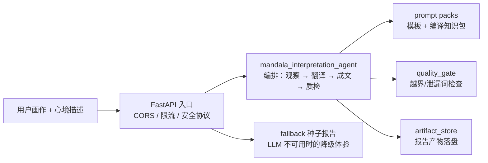

# 灵犀 Lingxi · Aimandala（一镜一梳 To C）

面向个人用户的曼陀罗绘画 AI 解读全栈产品：用户上传自己的曼陀罗画作并描述绘画时的心境，系统生成结构化解读报告（Lite / Pro 两档），并提供报告陪读 follow-up 对话。

> 本项目 2025 年起作为一个独立开发者的生产项目开发并真实上线运行（移动端 Web + 微信小程序 + 后端 API + 支付闭环），2026-08 起转入维护模式。此仓库为脱敏后的开源快照，供技术参考。

## 技术栈

| 层 | 技术 |
| --- | --- |
| 后端 | Python · FastAPI · Pydantic，ruff 质检，pytest 测试 |
| 视觉 / 文本 LLM 链路 | 双通道运行时（vision 观察 → 报告生成），支持多 provider |
| 前端 | 移动端 Web（Vite + React + TS）· 微信小程序原生 · native 壳 |
| 部署 | Docker Compose 多阶段构建 · nginx · 腾讯云 CVM（配置已脱敏为 example.com / 文档保留 IP） |

## 架构



核心设计点：

- **两阶段报告**：vision 观察稿（可复用基线）与议题报告生成分离，同一观察稿可承载多议题，避免重复视觉调用。
- **质量门**：生成后自动检查「跨圈五行泄漏」「人格边界越界」等模式，不通过则重写。
- **安全协议**：safety/protocol.py 声明不做心理诊断、不预测财务等表达边界。
- **Prompt 预算管理**：prompt_budget.py 对 pack 体积做 token 估算与告警。

## 知识库解耦说明（重要）

本项目的领域知识（疗愈体系知识库：解读方法、信号翻译表、范例案例）是**专有资产，不在开源范围**。代码通过路径注入读取知识库，不含任何知识内容：

- 运行时从 `docs/疗愈体系知识库/` 读取（本仓库不含该目录）；
- `generated_prompt_packs/` 是部署期由知识库编译出的 prompt 包（本仓库仅含 README）；
- 依赖真实知识包的端到端测试会自动 skip。

clone 后可直接查看全部编排逻辑、模板与测试；接入自己的知识源后即可完整运行。

## 快速开始

```bash
# 后端
cd toC/app/backend
pip install -r requirements.release.txt
uvicorn app.api.main:app --reload   # http://127.0.0.1:8000

# 前端（移动端 Web）
cd toC/app/frontend/mobile-web
pnpm install && pnpm dev
```

## 测试

```bash
cd toC/app/backend
python -m pytest tests/unit -q
```

不含专有知识资产的单元测试全部可运行；依赖知识包的 e2e 用例自动跳过（见 `tests/unit/test_mandala_e2e_agent.py` 顶部 skip 标记）。

## 目录

```
toC/app/backend/app/
  api/                 FastAPI 入口、路由、限流、降级种子报告
  core/
    mandala_interpretation_agent/   解读编排（本仓库核心）
    llm/               LLM 运行时与 prompts
    wealth_report/     财富议题报告链路
    safety/            表达边界协议
deploy/              Docker / nginx / 云部署配置（已脱敏）
docs/                spec / 架构 / 决策 / 交付记录（spec-first 治理）
fixtures/            测试样本目录（样本资产未包含）
scripts/             本地开发与环境脚本
```

## 免责声明

解读报告为艺术表达与自我反思辅助，不构成医疗、心理诊断或财务建议。

## License

MIT © MindSyncHub
